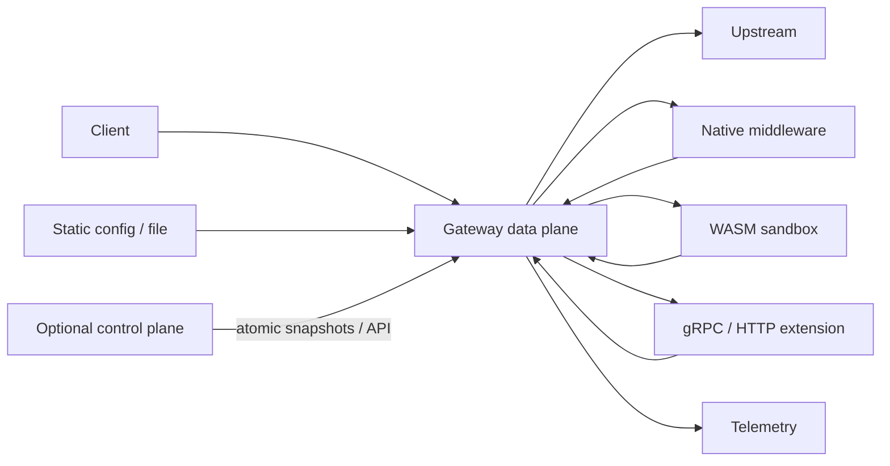
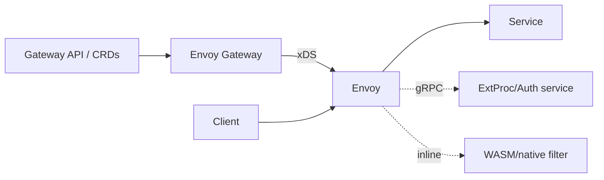
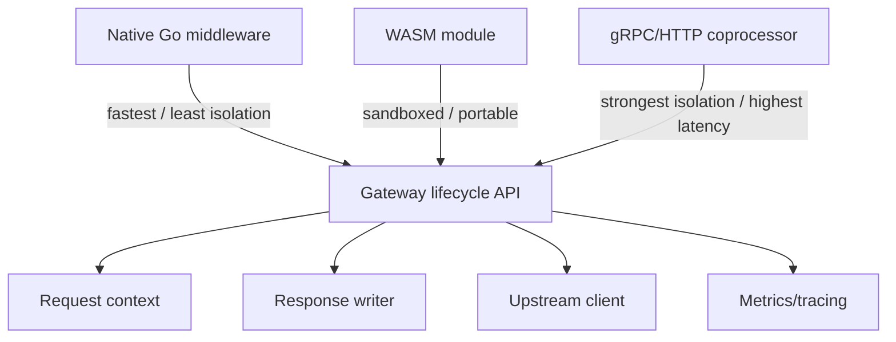
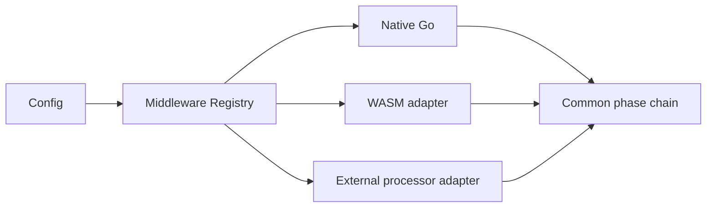
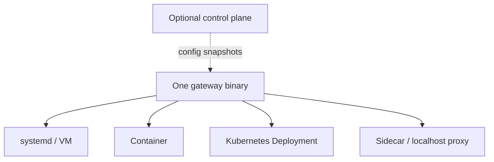

# Building a Minimal, Highly Extensible API Gateway in Go

## Executive summary

The gateway landscape falls into four architectural families. **Programmable proxy frameworks** such as Pingora and Caddy expose request-processing primitives directly and leave API-management semantics largely to the application. **Extensible reverse proxies/gateways** such as Envoy, Kong, Tyk, APISIX, Traefik, NGINX, HAProxy, KrakenD, Easegress, and Spring Cloud Gateway provide routing plus policy hooks, usually through filters, middleware, plugins, scripting, WebAssembly, or out-of-process RPC. **Gateway control planes** such as Envoy Gateway, Gloo Gateway, Higress, ShenYu, and Gravitee separate configuration-management concerns from a proxy/data plane. Finally, **managed API-management systems** such as AWS API Gateway, Azure API Management, Apigee, Cloudflare API Shield, and MuleSoft Flex Gateway emphasize governance, API lifecycle, portals, analytics, and managed policy execution rather than arbitrary in-process extension code. citeturn670208search8turn878070search5turn594548search0turn970143search4turn970143search7turn594548search8turn494877search8turn632964search2turn854181search4turn727449search0turn727449search5turn727449search7turn854181search0

For a **minimal Go gateway**, the strongest design lesson is not to reproduce a miniature Kong, Tyk, or Envoy. The most durable core is closer to a combination of **Pingora's programmable lifecycle**, **Go's `net/http` middleware ergonomics**, **Caddy's typed module registry**, and **Envoy's explicit distinction between in-process and out-of-process extensions**. Pingora is unusually unopinionated: it gives the application hooks at individual request phases and building blocks for load balancing, failover, caching and telemetry, but it is a Rust framework rather than an API-management product. Tyk is substantially more opinionated: its Go data plane comes with API definitions, authentication, quotas, analytics, GraphQL/API-management concepts, a control plane, portal, and multiple plugin mechanisms. citeturn670208search7turn670208search8turn970143search7turn494877search5turn494877search6

The recommended architecture is therefore a **single Go data-plane binary with a small immutable runtime configuration, a deterministic middleware chain, typed request context, atomic configuration snapshots, and zero mandatory external dependencies**. Native Go middleware should be the primary extension mechanism. Add **out-of-process gRPC/HTTP hooks** when isolation or language neutrality is required and **WASM only as an optional sandboxed extension tier**, not as the core plugin API. Avoid Go's standard-library `.so` plugin mechanism for the primary ecosystem because ABI/toolchain coupling makes distribution operationally brittle; KrakenD's Go-plugin documentation illustrates the power of native `.so` plugins but also why binary compatibility becomes part of deployment management. citeturn494877search9

Configuration should begin as **declarative YAML/JSON compiled into an immutable in-memory graph**, with validation and atomic hot replacement. Kong's DB-less configuration demonstrates the operational advantage of full-state declarative updates, while Caddy demonstrates that a JSON-native runtime model can coexist with human-friendly adapters. APISIX similarly supports both central configuration and standalone file-driven operation. This separation lets the minimal gateway start with a file and later acquire a control plane without changing the data-plane programming model. citeturn594548search4turn632964search4turn594548search8

Security and observability should be **core contracts, not plugins**: TLS/mTLS primitives, bounded request bodies, timeouts, panic recovery, header normalization, structured access logs, Prometheus/OpenTelemetry-compatible metrics and traces, and safe defaults for proxy headers should always exist. Authentication schemes, rate-limit stores, transformations, WAF rules, caching strategies, and business-specific authorization belong above this substrate as middleware. Envoy, Azure API Management, AWS API Gateway, Tyk and HAProxy all make the distinction visible in different ways: low-level transport/runtime behavior is stable infrastructure, whereas traffic policy is layered on top. citeturn594548search2turn727449search0turn727449search5turn494877search6turn878070search4

A recurring anti-pattern is letting every extension touch every internal object. Mature systems instead expose a constrained contract: Kong's PDK, Envoy's filter APIs and Proxy-Wasm ABI, Traefik's middleware interfaces, MuleSoft's PDK, Caddy modules, and Azure/Apigee policy languages all constrain extensions enough that the runtime can evolve independently. citeturn594548search5turn594548search0turn494877search7turn854181search2turn878070search6turn727449search6turn727449search8

Performance claims should be treated cautiously. Envoy explicitly states that there is no meaningful single QPS or latency number for a proxy because results depend strongly on connection reuse, TLS, HTTP version, filter chain and concurrency. Vendor-published results nevertheless indicate the broad performance envelope: APISIX advertises roughly 140k QPS on an eight-core AWS instance and ~0.2 ms added latency; Kong publishes test cases around 127k–135k RPS for a no-plugin configuration in its benchmark environment; Tyk documents approximately 68k RPS at 1.7 ms p99 for encrypted API-key authentication on an AWS c5.4xlarge; KrakenD's repository claims more than 70k RPS on a regular-sized instance; and Cloudflare says Pingora serves more than 40 million Internet requests per second across its fleet. These are **not directly comparable benchmarks**. citeturn594548search3turn970143search9turn594548search7turn494877search4turn632964search2turn670208search8

## Survey scope and evaluation model

No finite report can literally enumerate every proprietary, abandoned, embedded, cloud-specific, service-mesh and niche API gateway. This survey therefore covers the major actively maintained open-source gateway/proxy families and representative commercial or managed platforms that materially influence gateway architecture as of **31 October 2026**. Products whose primary role is a reverse proxy rather than full API management—Pingora, Caddy, HAProxy and NGINX—are included because they are particularly relevant to designing a minimal gateway.

The dimensions used are: implementation language; license; deployment model; process and control-plane architecture; extension boundary; configuration; published performance evidence; security; observability; traffic-management features; API-management/lifecycle features; ecosystem; and principal architectural tradeoff. Where the primary sources reviewed do not specify a property, the table states **unspecified** rather than inferring it.

### Architecture families



The architectural choice that matters most is the extension boundary. In-process native extensions minimize latency but share the gateway's crash and memory domain. Embedded interpreters improve reloadability but add another runtime. WASM adds sandboxing and language portability at some execution and tooling cost. External gRPC/HTTP processors give the strongest process isolation and language freedom but introduce serialization, network scheduling and failure semantics into the request path. Envoy, APISIX, Tyk, Traefik, Gloo and MuleSoft collectively implement essentially this full spectrum. citeturn594548search0turn594548search8turn494877search5turn494877search7turn669631search4turn854181search1

## Detailed comparison

| Project                   | License / language                                                                                      | Deployment and architecture                                                                                                                                                       | Extensibility                                                                                                                                                    | Configuration                                                                                                        | Performance evidence                                                                                                                        | Security / observability                                                                                                                                    | Feature breadth and principal tradeoff                                                                                                                   |
| ------------------------- | ------------------------------------------------------------------------------------------------------- | --------------------------------------------------------------------------------------------------------------------------------------------------------------------------------- | ---------------------------------------------------------------------------------------------------------------------------------------------------------------- | -------------------------------------------------------------------------------------------------------------------- | ------------------------------------------------------------------------------------------------------------------------------------------- | ----------------------------------------------------------------------------------------------------------------------------------------------------------- | -------------------------------------------------------------------------------------------------------------------------------------------------------- |
| **Pingora**               | Apache-2.0; Rust. citeturn732220search0                                                              | Library/framework compiled into your service; async proxy runtime rather than separate APIM control plane.                                                                        | Rust traits and lifecycle callbacks at request, upstream, body, response and logging phases. citeturn670208search7                                            | Application-defined; no canonical APIM config model.                                                                 | Cloudflare says deployments serve >40M Internet requests/s; not a controlled gateway benchmark. citeturn670208search8                    | TLS choices, mTLS peer support, observability foundations; auth/API-management features are application-defined. citeturn670208search8turn670208search9 | Load balancing, retries/failover, experimental caching; extremely programmable and minimally opinionated, but you build most APIM semantics yourself.    |
| **Envoy Proxy**           | Apache-2.0; C++. citeturn970143search0                                                               | Standalone proxy/container/sidecar; multi-threaded event-loop data plane usually configured by static config or xDS control plane. citeturn594548search2                       | Native C++ filters, Proxy-Wasm, Lua and external auth/processing patterns; Wasm executes inline on workers. citeturn594548search0                             | YAML/bootstrap plus dynamic xDS APIs.                                                                                | No canonical QPS by design; project publishes benchmarking methodology instead. citeturn594548search3                                    | mTLS, JWT/ext-auth patterns, rate limiting, rich metrics/tracing/logging.                                                                                   | Very broad L4/L7 routing, LB, retries, breakers, health checks; exceptionally flexible but configuration/API surface is large.                           |
| **Envoy Gateway**         | Apache-2.0; Go control plane + Envoy data plane. citeturn854181search7turn854181search8             | Kubernetes/standalone control plane managing Envoy fleets; explicit CP/DP split. citeturn854181search4turn854181search6                                                       | Wasm, Lua, extProc gRPC, xDS patching, extension servers, dynamic modules. citeturn594548search1                                                              | Gateway API + Envoy Gateway CRDs.                                                                                    | Inherits Envoy characteristics; canonical aggregate benchmark unspecified.                                                                  | Routing, TLS, retries, rate limits, auth and policy APIs; standardized Kubernetes experience, but intentionally Kubernetes/control-plane oriented.          |
| **Kong Gateway**          | Apache-2.0 core; primarily Lua/OpenResty with additional components. citeturn970143search4           | Binary/container/Kubernetes; DB-backed, DB-less or hybrid CP/DP. citeturn970143search6turn594548search4                                                                       | Lua PDK; Go, Python and JavaScript PDKs; large plugin ecosystem. citeturn594548search5                                                                        | Admin API/DB or declarative YAML/JSON; Konnect adds managed CP/UI. citeturn594548search4turn970143search5        | Official benchmark examples ~127k–135k RPS no-plugin under published test conditions. citeturn594548search7                              | Auth plugins, rate limiting, TLS, logging/metrics/tracing plugins.                                                                                          | Mature APIM/plugin ecosystem and managed platform; larger conceptual/runtime footprint than a minimal proxy.                                             |
| **Tyk Gateway**           | MPL-2.0 OSS core plus commercial `ee`; Go. citeturn970143search7                                     | Binary/container/Kubernetes; standalone OSS gateway, self-managed platform, hybrid/cloud CP/DP; MDCB supports distributed data planes. citeturn494877search1turn494877search6 | Native Go plugins, gRPC coprocess plugins and embedded JavaScript. citeturn494877search5                                                                      | API definitions, REST APIs, dashboard, GitOps/operator workflows. citeturn494877search2turn494877search6         | Published example ~68k RPS, 1.7 ms p99 on c5.4xlarge with encrypted key auth. citeturn494877search4                                      | Auth, quotas/rate limits, policies, OTel, structured logs/traces; analytics pipeline via Pump. citeturn494877search0turn494877search6                   | Full API/AI management and portal; excellent Go-native reference but substantially more opinionated than Pingora.                                        |
| **Apache APISIX**         | Apache-2.0; Lua/LuaJIT on NGINX. citeturn970143search9                                               | Traditional combined role, decoupled CP/DP or standalone; etcd commonly supplies dynamic config. citeturn594548search8                                                         | Native Lua plugins, external plugin runners, experimental Wasm. citeturn594548search8turn594548search10                                                      | etcd/Admin API or standalone YAML/JSON. citeturn594548search8                                                     | Project advertises ~140k QPS on AWS 8-core and ~0.2 ms added latency. citeturn970143search9                                              | Large auth, traffic-control and observability plugin catalog.                                                                                               | Dynamic hot configuration and 100+ plugins; depends heavily on NGINX/Lua/etcd architecture.                                                              |
| **Traefik Proxy**         | MIT; Go. citeturn632964search0turn632964search1                                                     | Single binary/container/Kubernetes edge proxy with dynamic provider discovery. citeturn494877search8                                                                           | Go middleware/provider plugins interpreted by Yaegi; newer WASM/http-wasm middleware plugins. citeturn494877search7                                           | Static config + dynamic config from files, Kubernetes, Docker and other providers. citeturn494877search8          | Official canonical benchmark: unspecified.                                                                                                  | TLS and middleware-based auth/limits; metrics/tracing/logging supported.                                                                                    | Excellent operational simplicity/service discovery; plugin runtime trades native compilation for interpreter/WASM portability.                           |
| **KrakenD**               | Apache-2.0 CE; Go. citeturn632964search3                                                             | Stateless binary/container; horizontally replicated without central persistence. citeturn632964search2                                                                         | Go `.so` plugins, Lua, CEL and Martian; multiple plugin insertion points. citeturn494877search9turn632964search2                                             | Declarative JSON, GitOps-oriented.                                                                                   | Repository claims >70k RPS on regular instance; older public benchmarks vary by hardware. citeturn632964search2turn669631search2        | JWT/OAuth-related security, rate limits, breakers; Prometheus/Datadog/Jaeger/Zipkin integrations. citeturn632964search2                                  | Strong BFF/aggregation and stateless deployment; compiled Go plugin ABI is operationally restrictive.                                                    |
| **Caddy**                 | Apache-2.0; Go. citeturn632964search4                                                                | Single static binary; generally one process; reverse proxy/web-server platform. citeturn878070search5                                                                          | Compile-time Go modules registered into typed configuration namespaces; `xcaddy` builds custom binaries. citeturn878070search6turn632964search4              | Native JSON API; Caddyfile and other adapters translate into JSON; live config API. citeturn632964search4         | Canonical gateway benchmark unspecified.                                                                                                    | Automatic HTTPS/TLS is core; tracing module and extensible logging.                                                                                         | Probably the cleanest Go module/config architecture in the survey, but not a full APIM platform by default.                                              |
| **HAProxy**               | GPL-2.0-or-later core; C. citeturn632964search5                                                      | Single event-driven, nonblocking, multithreaded process; binary/container. citeturn878070search4                                                                               | Embedded Lua and SPOE/SPOP offload services in arbitrary languages. citeturn878070search0turn878070search2                                                   | Text configuration + runtime/management interfaces.                                                                  | Project focuses on highly optimized event-driven forwarding; canonical APIM benchmark unspecified. citeturn878070search4                 | TLS, ACLs, rate/connection controls, Prometheus metrics and tracing facilities. citeturn878070search3                                                    | Outstanding proxy/load-balancer efficiency; API-management and developer lifecycle remain largely external.                                              |
| **NGINX / NGINX Plus**    | OSS NGINX 2-clause BSD; C; NGINX Plus commercial. citeturn732220search4                              | Master/worker binary/container; Plus adds commercial management capabilities.                                                                                                     | C dynamic modules, njs JavaScript and Lua modules; modules loaded as `.so`. citeturn669631search8turn669631search9                                           | `nginx.conf`; API/management additions vary by edition.                                                              | Canonical current API-gateway benchmark unspecified.                                                                                        | TLS, auth modules, limits; OTel and Prometheus-related modules available. citeturn669631search8                                                          | Battle-tested proxy substrate with huge ecosystem, but module ABI/configuration model is lower-level than modern APIM systems.                           |
| **Easegress**             | Apache-2.0; Go. citeturn518665search2                                                                | Go service with controllers and pipelines; also contains service-mesh/sidecar concepts and built-in Raft capabilities. citeturn670208search0                                   | Go filters/controllers and optional WasmHost. citeturn670208search3                                                                                           | YAML objects manipulated with `egctl`; controllers/pipelines/filters. citeturn670208search1                       | Quantitative current benchmark unspecified.                                                                                                 | JWT, OAuth2, basic auth, signatures, rate limiting; built-in statistics. citeturn670208search3                                                           | Very relevant Go pipeline design; broader orchestration/cluster scope increases complexity beyond a minimal gateway.                                     |
| **Apache ShenYu**         | Apache-2.0; Java. citeturn518665search0                                                              | Java gateway replicas plus ShenYu Admin; config synchronized by WebSocket, ZooKeeper or HTTP long polling. citeturn878070search8                                               | Ordered Java plugin chain, custom plugins/SPI and Wasm APIs. citeturn518665search0                                                                            | Admin database/UI; selectors/rules/JSON handles distributed to gateways. citeturn878070search9turn878070search10 | Unspecified.                                                                                                                                | Auth/traffic/observability plugins.                                                                                                                         | Powerful chain-of-responsibility and rule matching; admin/data synchronization model is more platform-like than minimal.                                 |
| **Higress**               | Apache-2.0; Go control plane with Envoy/Istio data plane. citeturn518665search1                      | Kubernetes-native control plane over Envoy/Istio; console available. citeturn878070search11                                                                                    | Wasm plugins in Go, Rust, JavaScript and other Wasm-capable languages. citeturn878070search11turn878070search12                                              | Kubernetes CRDs and console; plugin config can be global/domain/route scoped. citeturn878070search12              | Unspecified.                                                                                                                                | Auth plugins, AI/API policies and Envoy observability ecosystem.                                                                                            | Strong sandboxed extension story; tied closely to Kubernetes/Istio/Envoy.                                                                                |
| **Spring Cloud Gateway**  | Apache-2.0; Java. citeturn732220search1                                                              | Spring Boot application; WebFlux/Reactor or MVC variants. citeturn670208search4                                                                                                | Java `GatewayFilter`/global-filter style extension through Spring application code.                                                                              | Spring configuration/application code; external config depends on Spring ecosystem.                                  | Unspecified.                                                                                                                                | Integrates Spring Security, metrics and resiliency ecosystem. citeturn670208search4                                                                      | Excellent fit when the gateway is itself an application; JVM/Spring coupling and application-level extension differ from a neutral infrastructure proxy. |
| **Gravitee APIM**         | Apache-2.0 OSS repository; Java. citeturn518665search3turn518665search4                             | Gateway runtime plus management API, producer console, developer portal and optional hybrid components. citeturn670208search6                                                  | Java plugin families: policies, repositories, reporters, services, resources, connectors, identity providers. citeturn670208search5                           | Management API/UI/repositories.                                                                                      | Unspecified.                                                                                                                                | API key, OAuth/JWT/mTLS plans, rate limiting, cache, transformations and telemetry. citeturn670208search6                                                | Deep APIM extension model; necessarily larger platform footprint.                                                                                        |
| **Gloo Gateway**          | Mixed OSS/commercial offerings; Envoy data plane; Go-oriented control plane.                            | Control plane translates high-level configuration to Envoy xDS; request path remains in Envoy. citeturn669631search3                                                           | Envoy filters, Wasm and enterprise external gRPC processing; extProc can inspect/modify headers, bodies and trailers. citeturn669631search4turn669631search5 | Kubernetes CRDs/Gateway API depending product generation.                                                            | Inherits Envoy characteristics; separate canonical benchmark unspecified.                                                                   | Envoy security/traffic features plus enterprise APIM.                                                                                                       | Strong CP/DP isolation and rich Envoy ecosystem; operational/control-plane complexity is substantial.                                                    |
| **AWS API Gateway**       | Proprietary managed service; implementation language unspecified.                                       | Fully managed regional/edge service. citeturn727449search4                                                                                                                     | Lambda authorizers/integrations; no arbitrary in-process plugins. citeturn727449search1                                                                       | AWS API/CLI/CloudFormation/OpenAPI/console. citeturn727449search4                                                 | AWS states support for hundreds of thousands of concurrent API calls; internal implementation metrics unspecified. citeturn727449search0 | IAM, Cognito, JWT/Lambda authorization, throttling, WAF, CloudWatch, X-Ray, CloudTrail. citeturn727449search0                                            | API stages, canaries, caching, WebSockets and lifecycle tooling; high operational convenience, low runtime programmability.                              |
| **Azure API Management**  | Proprietary managed service; self-hosted gateway is containerized; implementation language unspecified. | Managed gateways plus optional Linux-container self-hosted data plane linked to Azure control plane. citeturn727449search5                                                     | XML-style policy language; external services/backends rather than arbitrary runtime modules. citeturn727449search6                                            | Portal/API/IaC; central Azure CP.                                                                                    | Quantitative canonical benchmark unspecified.                                                                                               | JWT/Entra/certs, quotas/rate limits, caching, circuit breakers, logs/metrics/traces. citeturn727449search5turn727449search6                             | Broad enterprise governance with hybrid runtime; policy DSL is powerful but platform-specific.                                                           |
| **Apigee**                | Proprietary managed/hybrid Google Cloud platform; implementation language unspecified.                  | Managed runtime with control/management plane; request proxies execute policies before forwarding. citeturn727449search7                                                       | Extensive policy DSL plus service-extension mechanisms; no general native in-process plugin ABI exposed to customers. citeturn727449search8                   | Management APIs/UI/API-proxy bundles.                                                                                | Unspecified.                                                                                                                                | API keys, OAuth, quotas, spike arrest, logging, analytics and enterprise API lifecycle. citeturn727449search8                                            | Highly mature policy/governance model; strongly opinionated and platform-centric.                                                                        |
| **Cloudflare API Shield** | Proprietary managed edge service; implementation language unspecified.                                  | Globally managed Cloudflare edge.                                                                                                                                                 | Extension primarily through Cloudflare rules/workers ecosystem rather than gateway-local modules.                                                                | Dashboard/API/Terraform/OpenAPI schema import. citeturn727449search9                                              | Internal edge performance metrics not specified in reviewed source.                                                                         | API discovery/schema validation, WAF integration and edge security controls. citeturn727449search9                                                       | Excellent edge/API-security integration; less analogous to a self-hosted programmable gateway.                                                           |
| **MuleSoft Flex Gateway** | Commercial; Envoy-based runtime. citeturn854181search0                                               | MuleSoft-hosted CP plus lightweight runtime; connected or local modes. citeturn854181search0turn854181search2                                                                 | Proxy-Wasm custom policies, primarily Rust through the PDK; policy config serialized as JSON. citeturn854181search1                                           | Connected API Manager or local YAML. citeturn854181search2turn854181search3                                      | Quantitative canonical benchmark unspecified.                                                                                               | mTLS CP/runtime connection and policy-based security/telemetry. citeturn854181search0                                                                    | One of the clearest commercial examples of sandboxed policy extensibility; ties runtime lifecycle to Anypoint concepts.                                  |

The comparison suggests a continuum rather than a winner. **Caddy, Pingora and Spring Cloud Gateway are application/framework oriented; Envoy, NGINX, HAProxy and Traefik are proxy oriented; Kong, Tyk, APISIX, KrakenD and Easegress sit between proxy and APIM; Gravitee, Azure APIM, Apigee and AWS sit increasingly toward API-management platform semantics.** This is an analytical classification rather than terminology imposed by the projects themselves. citeturn878070search5turn670208search8turn670208search4turn970143search4turn494877search6turn594548search8turn632964search2turn670208search0turn670208search6turn727449search0turn727449search5turn727449search7

## Per-project technical notes and extension sketches

### Pingora

Pingora is the best reference in this survey for the distinction between **gateway framework** and **gateway product**. A proxy application implements callbacks such as `request_filter`, `upstream_peer`, request/response-body filters and logging. The framework supplies asynchronous networking, connection pooling, load balancing and failure handling, but the application decides what an "API", "consumer", "policy" or "developer portal" means. citeturn670208search7turn670208search8


An illustrative Pingora-style extension is simply application code implementing its proxy trait:

```rust
async fn request_filter(&self, session: &mut Session, _ctx: &mut Ctx)
    -> Result<bool>
{
    if session.req_header().headers.get("x-api-key").is_none() {
        session.respond_error(401).await?;
        return Ok(true);
    }
    Ok(false)
}
```

The important architectural property is that this is **not a dynamically loaded plugin**; it is compiled into the service. That yields type safety and minimal indirection but means extension deployment is application deployment. citeturn670208search7

### Envoy and Envoy Gateway

Envoy separates network/proxy execution from configuration via xDS, making it a canonical example of explicit control-plane/data-plane architecture. Native filters execute inline inside Envoy workers; Proxy-Wasm maps lifecycle callbacks into sandboxed modules; external-processing designs move custom logic into another process. Envoy Gateway adds a Kubernetes-oriented control plane that translates Gateway API resources into xDS and can expose Wasm, Lua, extProc and xDS mutation extension points. citeturn594548search0turn854181search4turn594548search1



A simplified Proxy-Wasm callback looks conceptually like:

```rust
fn on_http_request_headers(&mut self, _: usize, _: bool) -> Action {
    if self.get_http_request_header("x-api-key").is_none() {
        self.send_http_response(401, vec![], None);
        return Action::Pause;
    }
    Action::Continue
}
```

Envoy's major tradeoff is that nearly every behavior is representable, but configuration and extension APIs are correspondingly large. Its own benchmark guidance cautions against collapsing proxy performance into a single QPS figure. citeturn594548search3

### Kong

Kong's important abstraction is the **PDK**. Plugins receive high-level request, response, service and logging primitives rather than manipulating NGINX/OpenResty internals directly. Kong supports DB-backed operation, DB-less YAML/JSON configuration and hybrid CP/DP deployment, which makes it a useful reference for evolving a simple gateway toward centralized management. citeturn594548search4turn594548search5

A minimal Lua plugin handler can be structured as:

```lua
local Plugin = { PRIORITY = 1000, VERSION = "0.1" }

function Plugin:access(conf)
  local key = kong.request.get_header("x-api-key")
  if key ~= conf.key then
    return kong.response.exit(401)
  end
end

return Plugin
```

The design lesson is the PDK boundary: custom logic sees a stable gateway API instead of raw implementation objects. Kong's disadvantage for a minimal Go design is that reproducing consumers, services, routes, plugins, persistence, management APIs and hybrid control-plane semantics would rapidly turn a small gateway into an APIM platform. citeturn594548search5turn970143search4

### Tyk

Tyk is particularly relevant because the gateway itself is written in Go. Its plugin options span native Go, out-of-process gRPC and embedded JavaScript, which neatly illustrate the performance/isolation continuum. Its broader platform adds a dashboard REST API, analytics, developer portal, distributed data-plane management and GitOps/operator workflows. citeturn494877search5turn494877search2turn494877search1turn494877search6

Conceptually, a native middleware extension resembles:

```go
func MyMiddleware(w http.ResponseWriter, r *http.Request) {
    if r.Header.Get("X-API-Key") == "" {
        http.Error(w, "unauthorized", http.StatusUnauthorized)
        return
    }
    // continue through Tyk's middleware contract
}
```

Tyk is far more opinionated than Pingora. Pingora provides callback phases and proxy primitives; Tyk already defines API objects, credentials, policies, quotas, analytics, GraphQL/API features and management-plane behavior. For a minimal gateway, borrow Tyk's **Go-native middleware ergonomics and optional coprocess boundary**, not its entire product model. citeturn670208search7turn494877search5turn494877search6

### Apache APISIX

APISIX runs routing and plugins in NGINX/LuaJIT workers while configuration typically arrives through etcd; it can also operate standalone from YAML/JSON. Plugins are scoped to routes, services or consumers and are inactive unless configured. APISIX also supports external plugin runners and experimental Wasm, which makes its architecture an instructive example of a very fast native scripting path plus slower isolated extension alternatives. citeturn594548search8turn594548search10

```lua
local plugin = {
    version = 0.1,
    priority = 1000,
    name = "require-key"
}

function plugin.access(conf, ctx)
    if not ctx.var.http_x_api_key then
        return 401
    end
end

return plugin
```

The 2021 APISIX Wasm experiment reported roughly 17.9k requests/s for its Wasm implementation, 11.9k for an external-plugin version and 32.4k for native Lua in that particular fault-injection test, illustrating the expected qualitative ordering rather than a universal ratio. citeturn594548search10

### Traefik

Traefik's runtime revolves around **entrypoints → routers → middleware → services**, while providers dynamically discover configuration. Its extension story is unusually interesting for Go: traditional plugins are Go code interpreted by Yaegi, while a newer system supports WebAssembly middleware based on `http-wasm`. citeturn494877search8turn494877search7

A middleware has the familiar Go shape:

```go
type Middleware struct {
    next http.Handler
}

func (m *Middleware) ServeHTTP(w http.ResponseWriter, r *http.Request) {
    r.Header.Set("X-Gateway", "minimal")
    m.next.ServeHTTP(w, r)
}
```

The advantage is easy Go authoring without requiring every plugin to be statically linked. The cost is maintaining an interpreter or Wasm host and defining which parts of Go or the host ABI are available. citeturn494877search7

### KrakenD

KrakenD is stateless and declarative, with a strong emphasis on API aggregation/BFF use cases. It supports Go shared-object plugins at several layers, plus CEL, Martian and Lua. Middleware plugins are the most powerful because they can modify request or response handling or terminate requests. citeturn632964search2turn494877search9

A conceptual Go middleware wrapper is:

```go
func Wrap(next http.Handler) http.Handler {
    return http.HandlerFunc(func(w http.ResponseWriter, r *http.Request) {
        if r.Header.Get("X-API-Key") == "" {
            http.Error(w, "unauthorized", 401)
            return
        }
        next.ServeHTTP(w, r)
    })
}
```

For a new Go gateway, KrakenD is a warning against making `.so` loading the _only_ native extension strategy. Native speed is excellent, but plugin and host must remain ABI/toolchain compatible. KrakenD itself documents plugins as separately compiled shared libraries with interface/build requirements. citeturn494877search9

### Caddy

Caddy is arguably the most useful Go architectural reference after the standard library. It is a single static binary whose capabilities are modules registered into named configuration namespaces. Third-party modules are normally compiled into a custom binary with `xcaddy`; native JSON configuration can be manipulated through an API, while Caddyfile/YAML-like formats can act as adapters into that canonical JSON model. citeturn878070search5turn878070search6turn632964search4

A Caddy-style module has approximately this shape:

```go
type Module struct{}

func (Module) CaddyModule() caddy.ModuleInfo {
    return caddy.ModuleInfo{
        ID: "http.handlers.example",
        New: func() caddy.Module { return new(Module) },
    }
}

func init() { caddy.RegisterModule(Module{}) }
```

This pattern strongly supports a minimal gateway design: **compile-time registry, typed module config, explicit provisioning, no runtime linker dependency**. The downside is that adding native modules produces a new gateway binary. citeturn878070search6

### HAProxy

HAProxy combines a highly optimized nonblocking C event loop with two extension paths: embedded Lua and the Stream Processing Offload Engine/Protocol, which can delegate work to external agents written in different languages. The Lua guidance explicitly warns against blocking the runtime thread and recommends per-thread Lua state on large machines where appropriate. citeturn878070search1turn878070search2turn878070search4

```lua
core.register_action("require_key", {"http-req"}, function(txn)
    if txn.sf:req_hdr("x-api-key") == nil then
        txn.res:set_status(401)
    end
end)
```

The design lesson is that **embedded scripting must have a strict nonblocking contract**. Without one, one extension can stall an event-driven proxy. citeturn878070search1

### NGINX

NGINX exposes C dynamic modules and scripting through njs and Lua modules. Dynamic modules are shared libraries loaded with `load_module`; njs allows JavaScript-like request logic while remaining integrated with the NGINX event model. citeturn669631search8turn669631search9

```javascript
function authorize(r) {
  if (!r.headersIn["X-API-Key"]) {
    r.return(401);
    return;
  }
  r.internalRedirect("@upstream");
}

export default { authorize };
```

NGINX demonstrates the longevity of a small event-driven core plus modules, but its configuration and C-module ABI are lower-level than an API gateway designed today would normally expose. citeturn732220search4turn669631search8

### Easegress

Easegress is a Go-native pipeline system. An `HTTPServer` controller routes to a `Pipeline`; each pipeline executes a configured flow of filters. Filters return result labels that can influence control flow through `JumpIf`. A `GlobalFilter` can wrap all pipelines. citeturn670208search1turn670208search2

```yaml
name: api
kind: Pipeline
flow:
  - filter: auth
  - filter: proxy
filters:
  - name: auth
    kind: Validator
  - name: proxy
    kind: Proxy
    pools:
      - servers:
          - url: http://backend:8080
```

Its `WasmHost` can load user Wasm with explicit concurrency and timeout bounds, although the feature is not enabled in the default build described by the reference documentation. citeturn670208search3

### Apache ShenYu

ShenYu applies an ordered chain of plugins. Each plugin can have selectors and rules; requests are progressively matched before the plugin executes. Configuration is kept in gateway-local caches and synchronized from the administration plane using mechanisms such as ZooKeeper, WebSocket or HTTP long polling. citeturn878070search8turn878070search10

A custom Java plugin conceptually implements an exchange transformation:

```java
public Mono<Void> execute(ServerWebExchange exchange,
                          ShenYuPluginChain chain) {
    if (!exchange.getRequest().getHeaders().containsKey("X-API-Key")) {
        exchange.getResponse().setStatusCode(HttpStatus.UNAUTHORIZED);
        return exchange.getResponse().setComplete();
    }
    return chain.execute(exchange);
}
```

The most reusable idea is the explicit separation between **plugin ordering** and **rule matching**. A minimal gateway should keep those concerns separate rather than having every middleware reimplement route predicates. citeturn878070search9turn878070search10

### Higress

Higress combines an Envoy/Istio data plane with Kubernetes-oriented control and makes WebAssembly a first-class plugin mechanism. Plugins can be configured globally, by domain or by route; route configuration overrides domain configuration, which overrides global configuration. citeturn878070search11turn878070search12

A representative plugin configuration is:

```yaml
apiVersion: extensions.higress.io/v1alpha1
kind: WasmPlugin
spec:
  defaultConfig:
    enabled: true
  matchRules:
    - config:
        requiredHeader: x-api-key
```

This hierarchy is useful for a minimal gateway: **global defaults + route overrides** is sufficient for most policy configuration without introducing a full policy inheritance language. citeturn878070search12

### Spring Cloud Gateway

Spring Cloud Gateway treats the gateway as a normal Spring application. Cross-cutting behavior is implemented through filters in either reactive WebFlux/Reactor or MVC-oriented variants. This makes extension trivial for Java teams because dependency injection, configuration, security and application code share one runtime. citeturn670208search4

```java
@Bean
GlobalFilter requestId() {
    return (exchange, chain) -> {
        exchange.getRequest().mutate()
            .header("X-Request-ID", UUID.randomUUID().toString())
            .build();
        return chain.filter(exchange);
    };
}
```

Its key tradeoff is exactly the reverse of Envoy's: developer ergonomics are excellent when the gateway is an application, but gateway and application runtime concerns become more tightly coupled. citeturn670208search4

### Gravitee

Gravitee has one of the broadest plugin taxonomies: identity providers, policies, reporters, repositories, resources, services, notifiers, alerts and protocol connectors. Policies execute in request and response chains; separate console, management API and developer portal components provide the API-management experience. citeturn670208search5turn670208search6

A conceptual policy contract is:

```java
public Completable execute(Request request, Response response) {
    if (request.headers().get("X-API-Key") == null) {
        return response.fail(401);
    }
    return Completable.complete();
}
```

The important lesson is that **not every extension is request middleware**. Reporters, repositories, configuration providers and protocol connectors deserve separate interfaces when the gateway grows. A minimal implementation, however, should postpone those extension families until there is a proven use case. citeturn670208search5

### Gloo Gateway

Gloo uses an Envoy data plane and a control plane that watches configuration and produces xDS. External processing is particularly notable: Envoy opens a bidirectional gRPC stream to an extProc server, which may inspect or modify request/response headers, body and trailers or terminate the request. citeturn669631search3turn669631search4

```proto
service ExternalProcessor {
  rpc Process(stream ProcessingRequest)
      returns (stream ProcessingResponse);
}
```

This architecture offers excellent language neutrality and failure isolation, but every external processor added to the synchronous request path becomes another latency and availability dependency. citeturn669631search4

### AWS API Gateway

AWS API Gateway deliberately does not expose an in-process user plugin interface. Custom authorization typically uses IAM, Cognito/JWT mechanisms or Lambda authorizers; backend behavior is configured through integrations. AWS manages traffic processing, throttling, monitoring, caching and lifecycle stages. citeturn727449search0turn727449search1turn727449search3

```yaml
x-amazon-apigateway-authorizer:
  type: request
  authorizerUri: arn:aws:apigateway:...:lambda:path/...
```

This is the opposite end of the extensibility spectrum from Pingora: operational ownership is minimized by constraining runtime extension. That is attractive for SaaS but not appropriate when a user wants an embeddable, highly programmable Go gateway. citeturn727449search4

### Azure API Management

Azure APIM's extension surface is its policy language rather than arbitrary gateway-native code. Policies cover JWT validation, header checks, IP filters, quotas, rate limits, caching, backend selection, load balancing and circuit breaking. Microsoft offers both managed gateways and a containerized self-hosted gateway that receives configuration from the Azure control plane. citeturn727449search5turn727449search6

```xml
<inbound>
  <validate-jwt header-name="Authorization" />
  <rate-limit calls="100" renewal-period="60" />
</inbound>
```

The design lesson is that a **restricted declarative policy DSL can cover a surprisingly large percentage of gateway use cases**, but introducing such a DSL too early creates another language to version and secure. citeturn727449search6

### Apigee

Apigee models API proxies as policy pipelines. Authorization, quota and spike-arrest policies can be attached conditionally to traffic, and the newer extension-processor model can apply Apigee policy logic to traffic outside a conventional Apigee proxy. citeturn727449search8

```xml
<Step>
  <Name>Verify-API-Key</Name>
  <Condition>request.header.host = "backend.example.com"</Condition>
</Step>
```

For a minimal gateway, Apigee's strongest lesson is not the XML syntax but **policy composition with explicit conditions and lifecycle stages**. Its weaker fit is the amount of platform metadata required to support full API-product and governance semantics. citeturn727449search7turn727449search8

### Cloudflare API Shield

API Shield is primarily a managed security layer rather than a generic programmable gateway. Its schema-validation feature consumes OpenAPI definitions, maps them to known operations, detects violations and lets users enforce results through WAF custom rules. citeturn727449search9

A comparable local-gateway configuration might be:

```yaml
security:
  openapi:
    file: ./openapi.yaml
    rejectUnknownOperations: true
```

The useful lesson is that OpenAPI can serve as **runtime security metadata**, not merely documentation. A minimal gateway should not bundle a complete WAF initially, but it should leave a hook for schema validators after route resolution and before upstream forwarding.

### MuleSoft Flex Gateway

Flex Gateway has a managed control plane but an Envoy-based runtime and uses Proxy-Wasm for custom policies. MuleSoft's PDK compiles Rust policy code to Wasm; JSON policy configuration is passed into the extension, and policies can be used in both connected and local modes. citeturn854181search0turn854181search1turn854181search2

```rust
fn on_http_request_headers(&mut self, _: usize, _: bool) -> Action {
    if self.get_http_request_header("x-custom-auth").is_none() {
        self.send_http_response(401, vec![], None);
        return Action::Pause;
    }
    Action::Continue
}
```

The architecture validates Wasm as a commercially viable policy boundary, but it also demonstrates the infrastructure required around Wasm—PDK, policy schema, packaging, distribution and host ABI. citeturn854181search1turn854181search3

## Extensibility patterns, tradeoffs and anti-patterns

Across the surveyed systems, six extension patterns recur.

**Compiled in-process interfaces** are used by Pingora, Caddy, Spring Cloud Gateway and native Go paths in Tyk. They provide the lowest invocation overhead, normal language tooling, compile-time type checking and straightforward debugging. Their central cost is operational: changing extension code generally means shipping a new process image or binary. Pingora and Caddy show that this is not necessarily a weakness; for infrastructure code, reproducible static binaries can be more reliable than dynamic plugin loading. citeturn670208search7turn878070search5turn878070search6

**Dynamically loaded native modules** appear in NGINX and KrakenD. They preserve native performance while decoupling distribution, but they expose host/compiler/ABI compatibility as a production concern. A new Go gateway should not make this its default plugin story. citeturn669631search8turn494877search9

**Embedded scripting** appears in Kong/Lua, APISIX/Lua, HAProxy/Lua, NGINX/njs and Tyk/JavaScript. It enables fast iteration and hot deployment, but the gateway must police CPU, allocation, blocking I/O and runtime safety. HAProxy's warning against blocking calls in Lua is a particularly clear example of the hazard. citeturn594548search5turn594548search8turn878070search1turn669631search9turn494877search5

**WASM** appears in Envoy, Traefik, Higress, MuleSoft Flex and Easegress. It offers a useful compromise: portable artifact, explicit host ABI and stronger isolation than native modules. Its anti-pattern is treating Wasm as "free multilingual native plugins." The host still needs memory/CPU limits, ABI/version management, module distribution, startup validation and asynchronous host functions. Envoy's documentation makes the worker-local execution and VM lifecycle explicit. citeturn594548search0turn494877search7turn878070search11turn854181search1turn670208search3

**External processing** appears in Envoy/Gloo extProc, Tyk gRPC coprocessors and HAProxy SPOE. It provides excellent fault/language isolation but should be reserved for policies where the isolation is worth a network/RPC boundary. A gateway that chains several synchronous RPC processors risks turning every request into a distributed transaction. citeturn669631search4turn494877search5turn878070search2

**Declarative policy languages** dominate managed systems such as Azure APIM and Apigee. They are operationally safe and amenable to validation, audit and GUI generation, but become a proprietary programming language once conditionals, variables, expressions and side effects accumulate. citeturn727449search6turn727449search8

Several anti-patterns emerge repeatedly. A gateway should not expose mutable global internals to plugins; permit blocking plugin work on event-loop goroutines; make the configuration database part of the synchronous request path; treat configuration updates as a sequence of partially applied mutations; allow plugins to bypass telemetry or transport invariants; load arbitrary untrusted native modules; hide policy ordering; or require a central control plane for basic operation. Kong's atomic declarative configuration, APISIX's standalone mode, Tyk's locally cached data-plane configuration and Envoy's worker-oriented extension execution all point toward data-plane independence and bounded extension contracts. citeturn594548search4turn594548search8turn494877search1turn594548search0

A useful conceptual model is:



For most gateway deployments, **90% of extension needs should be satisfiable by declarative composition of a small set of built-in middleware**, perhaps 9% by application-specific native Go middleware, and only the exceptional remainder by Wasm or out-of-process extensions. That percentage is a design target, not an empirically measured industry statistic.

## Recommended minimal Go gateway architecture

The recommended gateway should be opinionated about **runtime safety and interfaces** but deliberately unopinionated about API-management business concepts.

### Core object model

Use only five first-class runtime concepts:

```go
type Gateway struct {
    snapshot atomic.Pointer[Snapshot]
    server   *http.Server
}

type Snapshot struct {
    Router   Router
    Routes   map[string]*Route
    Plugins  map[string]MiddlewareFactory
}

type Route struct {
    ID         string
    Match      Match
    Upstreams  []Upstream
    Middleware []Middleware
    Policy     RoutePolicy
}

type Middleware interface {
    Handle(*Context, Next) error
}

type Next func(*Context) error
```

`Snapshot` should be immutable once installed. A configuration loader parses external configuration, performs schema and semantic validation, constructs routing indexes, instantiates middleware and upstream pools, and then performs one atomic pointer swap. Existing requests continue on the old snapshot; new requests use the new one. This combines Kong's full-state declarative updates with the simplicity of Caddy's canonical runtime model. citeturn594548search4turn632964search4

The request context should be deliberately smaller than `http.Request` plus "everything":

```go
type Context struct {
    Request  *http.Request
    Writer   http.ResponseWriter
    Route    *Route

    Principal *Principal
    Trace     trace.Span
    Values    Values

    upstreamRequest  *http.Request
    upstreamResponse *http.Response
}
```

Plugins should manipulate the gateway through accessor methods rather than receiving the `Gateway` object itself. That preserves the PDK-style compatibility boundary used successfully by Kong and Proxy-Wasm. citeturn594548search5turn594548search0

### Middleware lifecycle

A single generic `ServeHTTP` middleware chain is simple but eventually becomes awkward for retries and response streaming. A better minimal API uses explicit lifecycle stages while keeping one interface:

```go
type Phase uint8

const (
    PhaseRequest Phase = iota
    PhaseAuth
    PhaseRoute
    PhaseUpstream
    PhaseResponseHeaders
    PhaseResponseBody
    PhaseLog
)

type Middleware interface {
    Phases() PhaseSet
    Handle(phase Phase, ctx *Context, next Next) error
}
```

This borrows the explicit phase model from Pingora and Envoy without adopting their much larger API surfaces. citeturn670208search7turn594548search0

A native Go middleware can then remain extremely small:

```go
type RequireHeader struct {
    Name string
}

func (m *RequireHeader) Phases() PhaseSet {
    return Only(PhaseAuth)
}

func (m *RequireHeader) Handle(_ Phase, c *Context, next Next) error {
    if c.Request.Header.Get(m.Name) == "" {
        return c.JSON(401, map[string]string{
            "error": "missing credential",
        })
    }
    return next(c)
}
```

The gateway should guarantee that middleware ordering is deterministic and visible in diagnostics. Authentication, rate limiting, mutation and upstream selection should not depend on registration order hidden inside package initialization.

### Plugin registry

Prefer Caddy-like static registration:

```go
type MiddlewareFactory interface {
    Name() string
    Schema() json.RawMessage
    New(raw json.RawMessage, deps Dependencies) (Middleware, error)
}

var registry = map[string]MiddlewareFactory{}

func Register(f MiddlewareFactory) {
    if _, exists := registry[f.Name()]; exists {
        panic("duplicate middleware: " + f.Name())
    }
    registry[f.Name()] = f
}
```

Third-party native modules are then ordinary Go modules compiled into a distribution:

```go
import (
    _ "github.com/acme/gateway-auth"
    _ "github.com/acme/gateway-transform"
)
```

This intentionally resembles Caddy's compile-time module approach rather than Go `.so` plugins. citeturn878070search6turn494877search9

### Optional extension tiers

Add two optional adapters behind the same logical middleware contract.



A **WASM adapter** should initially expose only headers, method, URI, route metadata, small buffered bodies, local responses, logging and outbound asynchronous HTTP calls. Do not expose arbitrary memory or Go values. Define resource limits—maximum module memory, execution fuel/time and body-buffer size—from the first release.

An **external processor adapter** can use bidirectional gRPC and follow the useful parts of Envoy extProc: request headers, optional body chunks, response headers/body and the ability to continue or terminate. However, it should require explicit per-route timeouts and a `failure_mode: open|closed` setting because the extension is now another distributed dependency. Gloo's extProc architecture demonstrates why these semantics must be explicit. citeturn669631search4

### Configuration

The initial format should be YAML for humans but decode into a versioned canonical Go schema that is equally representable as JSON:

```yaml
version: gateway.openai.dev/v1alpha1

listeners:
  - address: ":8443"
    tls:
      certFile: ./cert.pem
      keyFile: ./key.pem

routes:
  - id: users
    match:
      host: api.example.com
      pathPrefix: /users
      methods: [GET, POST]

    upstreams:
      - url: http://users-a:8080
        weight: 2
      - url: http://users-b:8080
        weight: 1

    middleware:
      - name: request-id
      - name: jwt
        config:
          issuer: https://issuer.example.com
      - name: rate-limit
        config:
          rate: 100
          burst: 200

    policy:
      timeout: 5s
      retries: 2
```

Do not introduce a database initially. A management server can later accept complete candidate configurations through an authenticated API:

```text
PUT /v1/config
If-Match: <generation>
Content-Type: application/yaml
```

The data plane validates the whole document, constructs the candidate snapshot and swaps it atomically. This avoids the partial-state windows Kong specifically identifies with imperative configuration changes. citeturn594548search4

If a control plane is eventually required, it should publish **versioned snapshots** rather than remote database queries. The request path must never require the control plane.

### Routing and upstream behavior

The first release needs only host, exact/path-prefix, method and header matching; weighted round robin; active/passive health state; connect/header/request timeouts; retries for explicitly safe conditions; and connection pooling through Go's `http.Transport`.

Do not implement a sophisticated expression language initially. Simple typed match structures are easier to validate, optimize and introspect. ShenYu demonstrates how selector/rule complexity can grow once arbitrary conditions become part of the routing model. citeturn878070search9turn878070search10

Retries must be conservative. Retry only idempotent methods by default, before response headers have been committed, with bounded attempts and a total request deadline. Circuit breakers can arrive later as a stateful middleware/upstream policy.

### Security defaults

The minimal secure runtime should have TLS 1.2+ by default when TLS is configured, optional inbound and upstream mTLS, strict header parsing, hop-by-hop header removal, configurable trusted-proxy CIDRs, request-header/body size limits, connection/read/write/idle timeouts, panic recovery, SSRF-safe upstream configuration, and no unauthenticated admin listener on a public interface.

Authentication should ship as middleware for API key, JWT/JWKS and mTLS principal extraction. Authorization should use a small interface rather than being fused to authentication:

```go
type Authorizer interface {
    Authorize(ctx context.Context, p *Principal, r *Route) error
}
```

Rate limiting should have an in-memory token-bucket implementation and an optional distributed store interface. AWS API Gateway's documentation explicitly describes token-bucket throttling; Tyk demonstrates why clustered/global limits require shared state. citeturn727449search2turn494877search4

A full WAF should **not** be in the minimal core. Provide middleware hooks for schema validation or external WAF engines instead. Cloudflare's OpenAPI schema validation is a good model for where such validation logically fits. citeturn727449search9

### Observability defaults

Every request should produce a structured access event with at least request ID, trace ID, route ID, upstream, method, normalized path template, status, bytes in/out, total duration, upstream duration, retry count and middleware error category.

Metrics should include:

```text
gateway_requests_total{route,method,status_class}
gateway_request_duration_seconds{route}
gateway_upstream_duration_seconds{route,upstream}
gateway_active_requests{route}
gateway_upstream_errors_total{route,upstream,reason}
gateway_retries_total{route}
gateway_config_generation
gateway_config_reload_total{result}
```

Tracing should use OpenTelemetry semantic conventions where practical and create one server span plus upstream client spans. Middleware should be able to add span attributes but should not replace the tracer. This follows the general model used in mature gateways where observability remains infrastructure rather than plugin-owned behavior. Envoy exposes extensive runtime statistics; Tyk advertises native OTel metrics/logs/traces; Azure APIM emits logs, metrics and traces from the gateway. citeturn594548search2turn494877search6turn727449search5

### Deployment

The same binary should support four deployments without changing the gateway code:



The preferred default is **standalone binary/container with local declarative configuration**. Kubernetes should be an adapter, not an architectural prerequisite. A Gateway API controller can be added separately later, exactly as Envoy Gateway keeps high-level control-plane translation separate from Envoy's data-plane execution. citeturn854181search4turn854181search6

### Small implementation outline

A viable repository can remain small:

```text
cmd/gateway/
    main.go

internal/
    config/
        schema.go
        load.go
        validate.go

    runtime/
        gateway.go
        snapshot.go
        context.go
        chain.go

    router/
        router.go
        radix.go

    proxy/
        transport.go
        upstream.go
        retry.go

    middleware/
        registry.go
        requestid/
        accesslog/
        jwt/
        ratelimit/

    telemetry/
        metrics.go
        trace.go
        logging.go

    admin/
        server.go

extensions/
    wasm/
    extproc/
```

The hot path can remain conceptually simple:

```go
func (g *Gateway) ServeHTTP(w http.ResponseWriter, r *http.Request) {
    snap := g.snapshot.Load()

    route, params := snap.Router.Match(r)
    if route == nil {
        http.NotFound(w, r)
        return
    }

    ctx := acquireContext()
    defer releaseContext(ctx)

    ctx.Reset(w, r, route, params)

    if err := route.Chain.Execute(ctx); err != nil {
        renderGatewayError(ctx, err)
    }
}
```

Configuration reload is likewise intentionally boring:

```go
func (g *Gateway) Reload(raw []byte) error {
    cfg, err := config.Parse(raw)
    if err != nil {
        return err
    }

    if err := config.Validate(cfg); err != nil {
        return err
    }

    next, err := BuildSnapshot(cfg)
    if err != nil {
        return err
    }

    g.snapshot.Store(next)
    return nil
}
```

The design has one central invariant: **configuration building may be complicated; request execution must not be**.

The first production release should therefore contain routing, reverse proxying, weighted upstreams, health awareness, request IDs, access logging, Prometheus/OTel telemetry, API-key/JWT authentication, local rate limiting, TLS/mTLS, retries/timeouts, declarative configuration and atomic reload. Caching, circuit breakers, distributed limits, schema validation, WebSockets/gRPC specialization, Wasm, external processors, dynamic service discovery, Kubernetes Gateway API, developer portals, monetization and a centralized control plane should be layered in only when required.

That trajectory preserves the most valuable property seen in Pingora and Caddy—**the gateway remains understandable as a small program**—while leaving extension points broad enough to grow toward the capabilities demonstrated by Tyk, Kong, Envoy and APISIX without locking the core into their much more opinionated product models. citeturn670208search8turn878070search5turn494877search6turn970143search4turn594548search0turn594548search8
